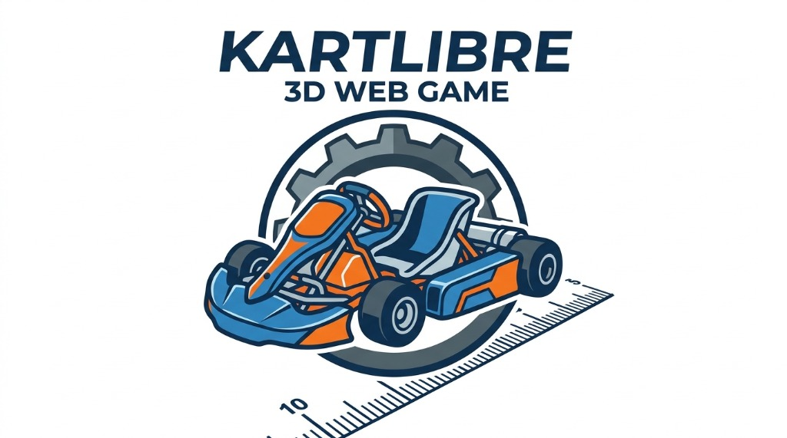

# 🏎️ KartLibre3D (Kart-Racer 3D)

Juego de carreras de kartings en 3D ambientado en el **Kartódromo Ciudad de Buenos Aires** (circuito oficial de 10 curvas), desarrollado con WebGL / Three.js, instalable como aplicación (**PWA**) en móviles y escritorio, y ejecutable directamente en el navegador.

## ✨ Características Principales

- **8 Corredores Oficiales con Karts Personalizados**:
  1. `#1 Nahuel` (Negro Grafito / Rojo)
  2. `#2 Ayrton` (Naranja Fuego / Negro)
  3. `#3 Santiago` (Rojo Competición / Azul)
  4. `#4 Alejandro` (Azul Eléctrico / Negro)
  5. `#5 Eduardo` (Verde Racing / Rojo)
  6. `#6 Mariano` (Púrpura / Amarillo Oro)
  7. `#7 Adrian` (Turquesa / Naranja)
  8. `#8 Lucas` (Blanco Perla / Rojo y Celeste)
- **Formato Oficial de Gran Premio (3 Etapas)**:
  - **Etapa 1**: 1 Vuelta de Reconocimiento.
  - **Etapa 2**: 3 Vueltas de Clasificación (ordena la parrilla de largada según el mejor tiempo de vuelta).
  - **Etapa 3**: 30 Vueltas de Carrera Final rueda a rueda contra los otros 7 corredores.
- **🌐 Modalidad Multijugador Online Opcional (Hasta 8 Jugadores)**:
  - **Crear Sala / Unirse con Código (`KART-XXXX`)** mediante WebRTC P2P (`PeerJS` + `BroadcastChannel` local).
  - **Personajes Exclusivos sin Repetir**: No pueden existir 2 corredores iguales en la misma sala (por ejemplo, si un jugador elige a `#2 Ayrton`, queda marcado como `🔒 OCUPADO` y los demás participantes eligen entre los corredores `🟢 LIBRE` restantes). Los karts que queden sin jugador humano son conducidos y sincronizados por la IA.
- **IA con Trazada Ideal y 3 Niveles de Dificultad**:
  - Configuración desde el menú inicial: **🟢 Fácil**, **🟡 Medio** y **🔴 Difícil**.
  - Los bots respetan los límites de la cinta asfáltica trazando las 10 curvas (Exterior → Ápice → Exterior) sin cortar por el pasto.
- **Física de Manejo Realista**:
  - Dirección progresiva sensible a la velocidad.
  - Derrape y deslizamiento centrífugo al entrar pasado de velocidad en curva (con sonido dinámico de chirrido de neumáticos).
- **Cámaras Duales y Clima Dinámico**:
  - Vista en **1ª Persona (Cockpit / Casco)** con telemetría digital MyChron en el volante y gotas de lluvia refractivas sobre el visor.
  - Vista en **3ª Persona (Exterior)** con modelo 3D anatómico del piloto (casco con bisagras, collarín HANS, arnés de 4 puntos, guantes y botas).

## 🎮 Controles

| Acción | Teclado | Pantalla / Mouse |
| :--- | :--- | :--- |
| **Acelerar** | `W` o `↑` | Pedal `ACEL` |
| **Frenar / Reversa** | `S` o `↓` | Pedal `FRENO` |
| **Doblar Izquierda / Derecha** | `A` / `D` o `←` / `→` | Botones `◀` / `▶` |
| **Boost / KERS** | `Espacio` o `Shift` | Botón `⚡ BOOST` |
| **Pausar / Salir al Menú** | `P` o `Esc` | Botón `⏸️ Pausa` |
| **Cambiar Cámara (1ªP / 3ªP)** | `C` | Botón `🎥 Cámara` |
| **Cambiar Clima (Lluvia / Seco)** | `V` | Botón `🌧️ Clima` |

## 📱 Instalación en Dispositivos Móviles (PWA) y Diseño Responsivo

- **Icono Oficial de App e Instalación**: Incluye `manifest.webmanifest` e iconos adaptativos (`assets/icon-512.png`, `assets/icon-192.png`, `assets/apple-touch-icon.png` y `assets/favicon.png`) para instalar **KartLibre 3D** en la pantalla de inicio de Android, iOS y PC.
- **Interfaz 100% Responsiva (Horizontal y Vertical)**:
  - Menú de inicio adaptable con desplazamiento táctil fluido.
  - Controles multitáctiles simultáneos: volante virtual con giro analógico por arrastre táctil + botones `◀` / `▶` en el pulgar izquierdo y pedales `ACEL`, `FRENO` y `⚡ BOOST` en el pulgar derecho.

## 🚀 Cómo Ejecutar

Haz doble clic en `Iniciar-Juego.bat` o abre `index.html` directamente en cualquier navegador moderno (Chrome, Edge, Firefox, Safari, Brave).

